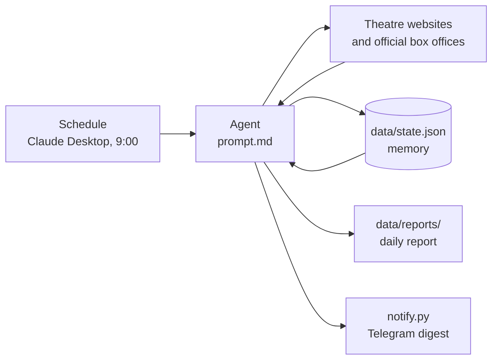

# theater-tickets

[Русский](README.md) · **English**

A Claude-based AI agent that checks Moscow theatre listings every morning and finds affordable tickets (up to 5,000 RUB) for 14 selected productions. It remembers what it found on previous runs, so each report highlights what changed: sales opened, new dates appeared, tickets got cheaper or are running out.

The project is built almost entirely with prompt engineering: all of the agent's logic lives in [`prompt.md`](prompt.md), and it runs as a scheduled task in Claude Desktop. The only code is a small script that sends Telegram notifications.

## Example output

A real agent report (in Russian): [`examples/report-2026-10-15.md`](examples/report-2026-10-15.md). An excerpt from its "What's new since the last check" section, translated:

> - 🔥 **"Pyl da nebyl" (Moscow Art Theatre, New Stage): sales opened today** for 1 Dec (from **3,000 RUB**) and 17 Dec (from **3,500 RUB**). Previously only "waiting list" and "sold out".
> - **"Grisha ne svidetel" (Praktika), 25 Nov:** noticeably fewer tickets left. **4 seats remain, all at 4,500 RUB**; on 11 Oct there were 46 seats from 3,000 RUB.

Each report has four parts: changes since the last check, up to 10 cheapest options with purchase links, a table covering all 14 productions, and notes on sources.

## How it works



1. A scheduled task in Claude Desktop starts a fresh Claude session every day with the instructions from `prompt.md`.
2. The agent reads `data/state.json`: what was known last time and which links and sources it has already found.
3. It decides which productions to check today (see "Making it faster") and checks them on theatre websites and official ticket sellers: Yandex Afisha, Ticketland, tickets.mos.ru and others.
4. It compares the results with the previous state, saves the new state and writes the report.
5. It sends a short digest to Telegram via [`notify.py`](notify.py): what's new and up to 5 best options with links. The digest arrives after every run, even when nothing changed.

## Design decisions and constraints

- **Read-only.** The agent never buys or reserves tickets, signs in, fills in forms or accepts cookies. The purchase decision stays with a human.
- **Official sources first.** Resellers are listed separately, with a warning, and only when there is no official sale.
- **No bypassing CAPTCHAs or bot protection.** When a source is closed (for example, Theatre of Nations' seating map is behind Yandex SmartCaptcha), the agent uses the last known data and says so explicitly in the report.
- **No made-up data.** If a price or seat availability couldn't be verified, the report says so.
- **The agent checks the input itself.** Two productions in the original list had the wrong theatre. The agent found where they are actually staged ("Beg" at the Vakhtangov Theatre, "Drums in the Night" at the Pushkin Theatre) and flagged it.
- **Sandboxed writes.** The agent only writes files to `data/` and never commits or pushes.

## Making it faster

The first runs re-crawled every site from scratch and took hours. To cut the time, the agent checks productions by priority:

| Group | How often |
|---|---|
| Tickets available up to 5,000 RUB, or nothing known yet | daily |
| Sold out, sales not open yet, or only above 5,000 RUB | every 3 days |
| All 14 productions | every Monday |

The agent also stores direct links and fast data sources (such as the Vakhtangov Theatre box office's JSON feed) and goes straight to them instead of searching. It only opens a browser when prices load dynamically.

A run still takes a while, usually 20 minutes to an hour, because many box offices only show prices on an interactive seating map.

## Running it yourself

1. Install [Claude Desktop](https://claude.ai/download) and clone this repository.
2. In `prompt.md`, edit the list of productions, the budget and the paths to the `data/` folder.
3. Open the project folder in the Code tab and ask Claude to create a Scheduled task with the text of `prompt.md` and the run time you want.
4. Set up the Telegram bot:
   - create a bot with [@BotFather](https://t.me/BotFather) using `/newbot`;
   - copy `.env.example` to `.env` and put the token in `TELEGRAM_BOT_TOKEN`;
   - open your bot in Telegram and press "Start";
   - run `python notify.py setup` (it saves your chat id to `.env`), then `python notify.py test`.
5. Click "Run now" and allow web search, the built-in browser and running `python notify.py` ("Always allow") so future runs don't stop on permission prompts.

Scheduled tasks run while Claude Desktop is open. If the app was closed, the check runs the next time it opens.

## Repository layout

```
├── prompt.md          agent instructions (in Russian)
├── notify.py          sends the digest to Telegram (Python standard library only)
├── .env.example       Telegram settings template (.env is not in the repo)
├── examples/          a real report
├── data/              (not in the repo) state.json and daily reports
├── README.md          Russian description
├── README.en.md       this file
└── LICENSE
```

## Ideas for the future

- An instant alert the moment sales open, not just in the morning digest.
- Move the list of productions and the budget into a separate config file instead of the prompt text.

## License

[MIT](LICENSE)
