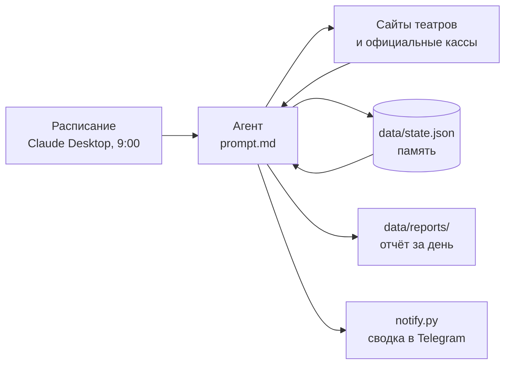

# theater-tickets

**Русский** · [English](README.en.md)

ИИ-агент на базе Claude, который каждое утро проверяет афиши театров Москвы и находит недорогие билеты (до 5000 ₽) на 14 выбранных спектаклей. Он запоминает результаты прошлых проверок и в отчёте показывает, что изменилось: открылись продажи, появились новые даты, подешевели или заканчиваются билеты.

Проект почти целиком сделан на промпт-инжиниринге: вся логика агента описана в [`prompt.md`](prompt.md), а запускается он как задача по расписанию в Claude Desktop. Код есть только в небольшом скрипте отправки уведомлений в Telegram.

## Пример результата

Реальный отчёт агента: [`examples/report-2026-10-15.md`](examples/report-2026-10-15.md). Фрагмент раздела «Новое с прошлой проверки»:

> - 🔥 **«Пыль да небыль» (МХТ, Новая сцена): сегодня открылись продажи** на 1.12 (от **3000 ₽**) и 17.12 (от **3500 ₽**). Раньше были только «лист ожидания» и «нет мест».
> - **«Гриша не свидетель» (Практика), 25.11:** билетов стало заметно меньше. Осталось **4 места, все по 4500 ₽**; 11.10 было 46 мест от 3000 ₽.

Каждый отчёт состоит из четырёх частей: изменения с прошлой проверки, до 10 самых дешёвых вариантов со ссылками на покупку, таблица по всем 14 спектаклям и примечания об источниках.

## Как это работает



1. Задача по расписанию в Claude Desktop каждый день запускает новую сессию Claude с инструкцией из `prompt.md`.
2. Агент читает `data/state.json`: что было известно в прошлый раз, какие ссылки и источники уже найдены.
3. Он решает, какие спектакли проверять сегодня (см. «Ускорение»), и проверяет их на сайтах театров и в официальных кассах: Яндекс Афиша, Ticketland, tickets.mos.ru и других.
4. Сравнивает с прошлым состоянием, сохраняет новое состояние и пишет отчёт.
5. Отправляет короткую сводку в Telegram через [`notify.py`](notify.py): что нового и до 5 лучших вариантов со ссылками. Сводка приходит после каждой проверки, даже если ничего не изменилось.

## Решения и ограничения

- **Только чтение.** Агент ничего не покупает и не бронирует, не входит в аккаунты, не заполняет формы и не принимает cookie. Решение о покупке остаётся за человеком.
- **Официальные источники в первую очередь.** Перекупщики показываются отдельно и с предупреждением, только если официальной продажи нет.
- **Капчи и защиту от ботов агент не обходит.** Если источник закрыт (например, схема зала Театра Наций за Yandex SmartCaptcha), агент берёт последние известные данные и прямо помечает это в отчёте.
- **Не выдумывать данные.** Если цену или наличие мест проверить не удалось, в отчёте так и написано.
- **Агент сам уточняет данные.** В исходном списке у двух спектаклей театр был указан неточно. Агент сам нашёл, где они идут на самом деле («Бег» — Театр Вахтангова, «Барабаны в ночи» — Театр им. Пушкина), и сообщил об этом.
- **Песочница.** Агент пишет файлы только в `data/`, ничего не коммитит и не пушит.

## Ускорение

Первые запуски обходили все сайты заново и шли часами. Чтобы сократить время, агент проверяет спектакли по приоритетам:

| Группа | Как часто |
|---|---|
| Есть билеты до 5000 ₽ или о спектакле ещё ничего не известно | каждый день |
| Нет мест, продажи не открыты, только дороже 5000 ₽ | раз в 3 дня |
| Все 14 спектаклей | по понедельникам |

Агент также запоминает прямые ссылки и быстрые источники (например, JSON-выгрузку кассы Театра Вахтангова) и идёт сразу к ним, а не через поиск. Браузер он открывает, только если цены грузятся динамически.

Проверка всё равно занимает заметное время, обычно от 20 минут до часа: многие кассы показывают цены только в интерактивной схеме зала.

## Как запустить у себя

1. Установите [Claude Desktop](https://claude.ai/download) и склонируйте репозиторий.
2. Отредактируйте в `prompt.md` список спектаклей, бюджет и пути к папке `data/` под себя.
3. Откройте папку проекта во вкладке Code и попросите Claude создать задачу по расписанию (Scheduled task) с текстом из `prompt.md` и нужным временем запуска.
4. Настройте Telegram-бота:
   - создайте бота в [@BotFather](https://t.me/BotFather) командой `/newbot`;
   - скопируйте `.env.example` в `.env` и впишите токен в `TELEGRAM_BOT_TOKEN`;
   - откройте своего бота в Telegram и нажмите «Запустить»;
   - выполните `python notify.py setup` (chat id сохранится в `.env` сам), затем `python notify.py test`.
5. Нажмите «Run now» и разрешите агенту поиск в интернете, встроенный браузер и запуск `python notify.py` («Always allow»), чтобы следующие запуски не останавливались на запросах разрешений.

Задачи по расписанию выполняются, пока открыт Claude Desktop. Если приложение было закрыто, проверка запустится при следующем открытии.

## Структура репозитория

```
├── prompt.md          инструкция агента
├── notify.py          отправка сводки в Telegram (только стандартная библиотека Python)
├── .env.example       шаблон настроек Telegram (.env не в репозитории)
├── examples/          пример реального отчёта
├── data/              (не в репозитории) state.json и ежедневные отчёты
├── README.md
├── README.en.md
└── LICENSE
```

## Идеи на будущее

- Отдельное срочное уведомление сразу, как только открываются продажи, а не только в утренней сводке.
- Список спектаклей и бюджет в отдельном конфиг-файле вместо текста промпта.

## Лицензия

[MIT](LICENSE)
